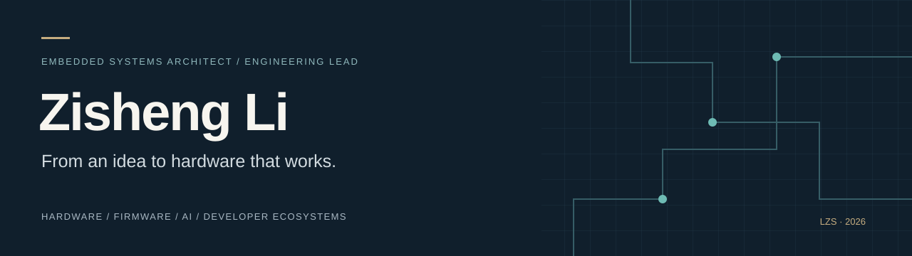
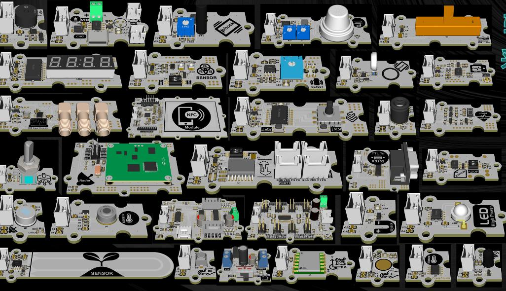
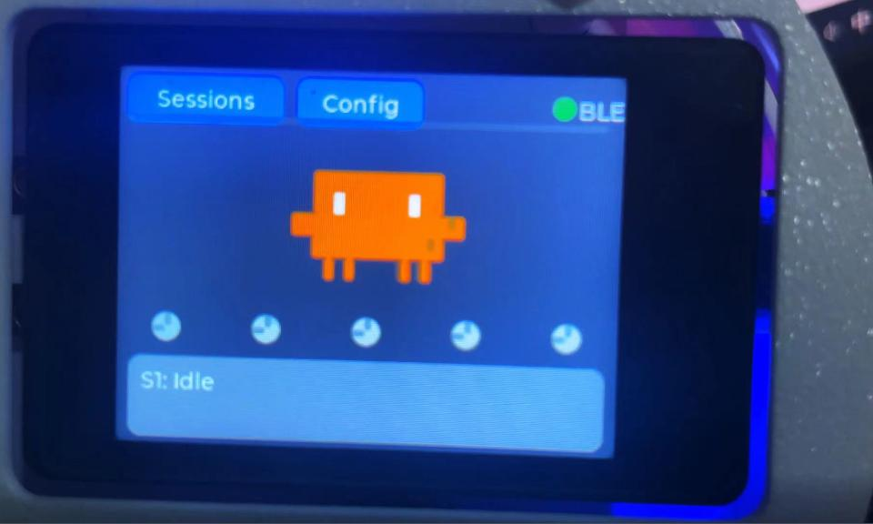
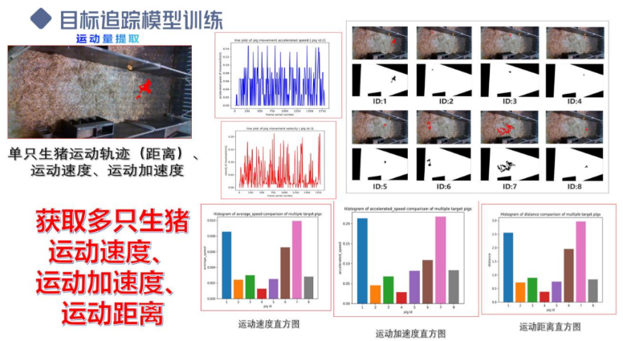
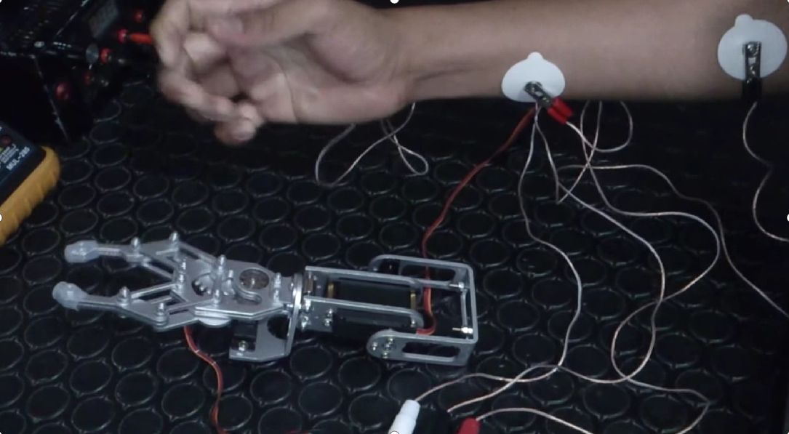
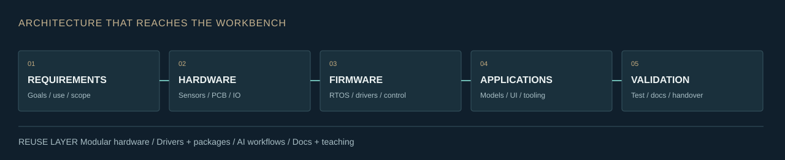
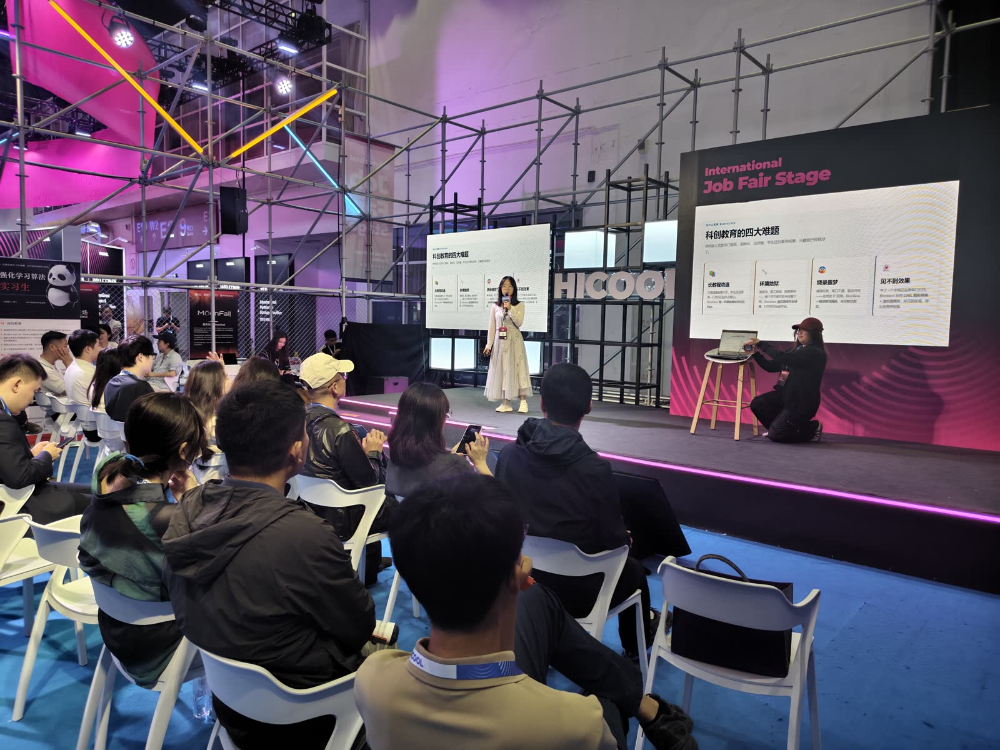
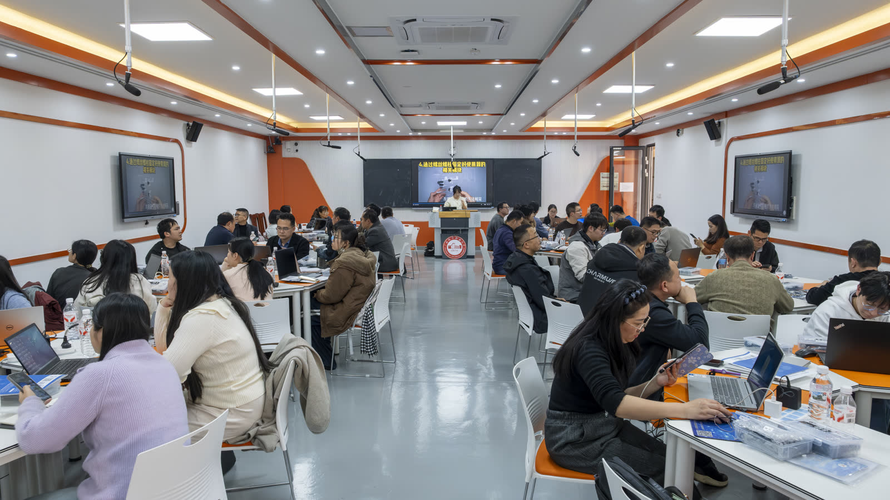

<b>English</b> · <a href="README.zh-CN.md">简体中文</a>

<table>
<tr>
<td width="72%" valign="top">

### I connect the architecture to the workbench.

I'm **Zisheng Li (李子圣)**, an embedded systems engineer, hardware entrepreneur and **Engineering Lead at [Anvol](https://anvol.dev)**. I founded **FreakStudio** and lead work across intelligent sensing, modular hardware, developer tools and product prototyping.

My work spans requirements, electronics, real-time firmware, algorithms, device interfaces and validation. I turn that experience into reusable drivers, AI development workflows and teaching systems that other people can build on.

**Focus:** embedded systems architecture · AI + hardware · developer ecosystems · engineering delivery

[Email me](mailto:1069653183@qq.com) · [FreakStudio](https://freakstudio.cn) · [Organization](https://github.com/FreakStudioCN)

</td>
<td width="28%" align="center" valign="middle"> Zisheng Li · 李子圣</td>
</tr>
</table>

| **8** granted patents | **4** research papers | **7** software copyrights | **282** uPyPI packages |
| :---: | :---: | :---: | :---: |
| Named inventor; 5 invention + 3 design | Sensing, IoT and vision | Personally named registrations | Community platform; snapshot Nov 1, 2026 |

## Platforms & developer ecosystems

I work across the hardware, software and workflow layers of the FreakStudio ecosystem, with contributions from our engineering team and upstream open-source communities.

| Platform | What it brings together | Explore |
| --- | --- | --- |
| **Blockless** | An AI-assisted path from a hardware idea to component selection, wiring, MicroPython firmware and guided deployment. | [VS Code extension + backend](https://github.com/FreakStudioCN/mpy-hardware-extension) |
| **Blockless Make APP** | Browser-based MicroPythonOS app generation, preview, MPK packaging and device deployment. | [App builder](https://github.com/FreakStudioCN/micropythonos-ai-app-builder) |
| **GraftSense + uPyPI** | Modular hardware, reusable drivers, examples and package discovery/distribution. | [Drivers](https://github.com/FreakStudioCN/GraftSense-Drivers-MicroPython) · [Package platform](https://upypi.net) |
| **MicroPython Skills** | Engineering knowledge encoded as reusable workflows for projects, drivers, validation and apps. | [Skills](https://github.com/FreakStudioCN/MicroPython_Skills) · [English edition](https://github.com/FreakStudioCN/MicroPython_Skills_EN) |
| **Blockless PCB Studio** | Modular backplane planning, 2D/3D review, BOM/export and an optional KiCad workflow. An engineering prototype requiring review before fabrication. | [Planner](https://github.com/FreakStudioCN/blockless-csp-assembler) · [Studio](https://github.com/FreakStudioCN/blockless-pcb-studio) |

**Upstream & distribution:** MicroPythonOS, LVGL and BIPES are upstream community projects; our forks support integration and experiments. uPyStore is part of the app-distribution work; its domain returned HTTP 404 on November 1, 2026, so it is not presented as a live service.

## Selected work

<table>
<tr>
<td width="50%" valign="top"> <b>01 / Modular hardware as a system</b>
GraftSense and GraftPort connect sensors, interfaces, drivers, examples and course materials. My focus is the reusable engineering layer between individual modules and a complete application.
<a href="https://github.com/FreakStudioCN/GraftSense-Drivers-MicroPython">Driver ecosystem →</a></td>
<td width="50%" valign="top"> <b>02 / AI workflows you can see and hear</b>
Physical desktop assistants turn coding-agent status into device feedback through embedded firmware, BLE, screens, light and voice. I work on the device and integration layer.
<a href="https://github.com/FreakStudioCN/MicroPython_Claude_Assistant_Public">Public companion project →</a></td>
</tr>
<tr>
<td width="50%" valign="top"> <b>03 / From camera data to useful signals</b>
Animal-health and behavior research prototypes combine YOLO, DeepSORT, movement features, anomaly analysis and desktop visualization. My work includes model pipelines, interfaces and edge integration.
<a href="https://github.com/leezisheng/pig_healthy_pytorch">Health-monitoring code →</a> · <a href="https://github.com/leezisheng/Animal_behavior_analysis">Behavior analysis →</a></td>
<td width="50%" valign="top"> <b>04 / Human signals to physical motion</b>
sEMG acquisition, filtering, neural-network regression, MCU control and host visualization form a complete research prototype. My work connects Keras models with STM32 firmware and system testing.
<a href="https://github.com/leezisheng/SEMG_Assistant">Signal-analysis software →</a> · <a href="https://github.com/leezisheng/MCU_Project">MCU experiments →</a></td>
</tr>
</table>

**More team product work:** [PottedBaby](https://github.com/FreakStudioCN/PottedBaby) · [PixelSky](https://github.com/FreakStudioCN/PixelSky) · [Voice companion](https://github.com/FreakStudioCN/danke_ai) · [BOM tools](https://github.com/FreakStudioCN/BOM-SelfPurch_Parts_List_Proc-Toolkit)

## How I approach a system

| Layer | Working experience |
| --- | --- |
| **Hardware & sensing** | Sensor interfaces, PCB bring-up, analog acquisition, motor drivers, power and communications. |
| **Embedded & control** | STM32, ESP32, RP2040/RP2350, MicroPython, FreeRTOS, HAL integration, PID and peripheral protocols. |
| **AI & applications** | OpenCV, Keras, detection/tracking, signal processing, PyQt, LVGL and device/host integration. |
| **Engineering & teams** | Requirements decomposition, testable milestones, prototype integration, documentation, technical teaching and cross-disciplinary collaboration. |

## Private engineering work

Some of my current work lives in private repositories. The summaries below describe my work at a capability level.

| Work area | My work and engineering context |
| --- | --- |
| AI music hardware | Embedded audio prototype iteration, device controls and displays, host-assisted testing, and the transition from experiments to an engineering sample. |
| Physical AI companions | Device firmware, BLE/Wi-Fi communication, UI and voice feedback, configuration and integration work. A public companion edition is linked above. |
| Customer-to-engineering workflows | Requirements discovery, bilingual engineering briefs, scope and acceptance criteria, contract/SOW preparation and reviewable handoff documents. |
| Commercial operations tools | Evidence-backed hardware research, communication workflows, content preparation and sales-support materials; my contributions sit within a broader team system. |
| Developer productivity | IDE package-management integration, MicroPython middleware test experiments, and document collection/organization tools. |
| Web and platform integration | Team product work covering browser interfaces and backend services for hardware workflows. |

## Recent engineering focus

| Period | Work |
| --- | --- |
| **Oct 2026** | Driver review and experimental async integration, with explicit validation labels and installation/runtime checks. [Public commit](https://github.com/FreakStudioCN/GraftSense-Drivers-MicroPython/commit/a34bed7a4426a64841e5a7019bc9c8919938837b) |
| **Aug–Oct 2026** | Refining MicroPython project/app workflows, release preparation and reusable engineering skills. [Skills history](https://github.com/FreakStudioCN/MicroPython_Skills/commits/main/?author=leezisheng) |
| **Sep–Oct 2026** | Private hardware sample iteration and tools connecting customer requirements, engineering review and delivery documents. |

[**Browse all 66 public repositories and the activity snapshot →**](docs/REPOSITORIES.md) · [中文项目目录](docs/REPOSITORIES.zh-CN.md)

The catalog covers my account and FreakStudioCN, including forks and reference repositories. Commit figures describe individual repository histories, include merges and are not added together as a personal contribution score.

## Beyond the repository

<table>
<tr>
<td width="50%"> <b>From prototype to public demonstration</b> Team product presentation · HICOOL 2026</td>
<td width="50%"> <b>From engineering to a learning system</b> Team teacher training · 80+ teachers, 30+ schools · Jan 2026</td>
</tr>
</table>

**My path:** embedded software practice at Redtea Mobile → founder of Qinghezhidao / FreakStudio → intelligent sensing research, product engineering and developer ecosystems. I am pursuing a master's degree in Electronic Information Engineering at North University of China (2024–present).

## Let's build something that works.

I welcome conversations about embedded architecture, intelligent hardware, sensor systems, robotics prototypes and developer tools.

**[1069653183@qq.com](mailto:1069653183@qq.com)** · [Anvol engineering](https://anvol.dev) · [FreakStudio knowledge base](https://freakstudio.cn) · [GitHub organization](https://github.com/FreakStudioCN)

Updated November 1, 2026. Personal work, collaborative work and upstream projects are identified in context. Photos show real hardware, research prototypes and team activities.
